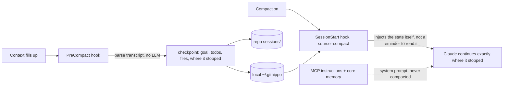

<p align="center">
  
</p>

<p align="center">
  <a href="https://github.com/AnxovatomicaES/githippo/actions/workflows/ci.yml"></a>
  
  
  
  
</p>

<h3 align="center">Claude forgets everything when the context compacts.<br>githippo doesn't.</h3>

<p align="center">
  
</p>

Long-term memory for Claude and any MCP client, stored as plain Markdown in a git repo **you own**. Hybrid semantic search, a knowledge graph, auto-memory and compaction survival, at about 790 tokens of tool overhead per turn. Every memory is a git commit you can read, diff and revert.

```bash
curl -fsSL https://raw.githubusercontent.com/AnxovatomicaES/githippo/main/install.sh | sh
```

That's the whole install: no account, no token, no questions. It sets up a local memory vault, wires Claude Code (hooks, MCP, status line) and fetches semantic search in the background. Restart Claude Code and just talk; it remembers.

Want it backed up and synced across machines? `githippo sync --github` creates a private repo with your existing GitHub CLI login and pushes after every change. Just curious? `npx -y github:AnxovatomicaES/githippo#v3.8.1 demo` shows it working in 30 seconds without installing anything.

<p align="center">
  <a href="https://render.com/deploy?repo=https://github.com/AnxovatomicaES/githippo"></a><br>
  <sub>one click → use it from claude.ai and your phone</sub>
</p>

---

## Why another memory server?

Because each good idea out there lives in a different tool. githippo takes the best of each and fixes the part that hurts:

| Idea | Borrowed from | githippo's twist |
|---|---|---|
| Entities + relations + observations | MCP reference memory server | Entities are Markdown files, relations are `[[wikilinks]]`, and search is **semantic, not substring**: "the language I prefer" finds "TypeScript" |
| Markdown you can edit, Obsidian graph | Basic Memory | Same human-readable files, but **synced through git**: every device, full history, zero cloud fees |
| Typed relations (`works_on [[x]]`) | Basic Memory, Dataview | Parsed into a queryable graph; recall follows links one hop automatically |
| Temporal facts ("what was true last quarter?") | Graphiti / Zep | Superseded facts move to a dated **History** section instead of vanishing, *and* `history at=<date>` gives exact time travel from git, with no graph DB and no LLM calls |
| Pinned "core memory" blocks | Letta (MemGPT) | Core memory rides **inside the MCP server instructions**, which live in the system prompt, so it survives compaction in *every* client, including claude.ai |
| Lifecycle hooks around compaction | claude-mem | The PreCompact hook builds the checkpoint **deterministically from the transcript** (goal, todo state, files changed, where it stopped). No LLM, no cost, can't hallucinate |
| Progressive disclosure | claude-mem | `recall mode=brief` returns one-line refs (~45 tokens) before you pay for full context |
| Consolidation / dedupe | mcp-memory-service, Mem0 | Embedding-based duplicate detection on every write, plus `maintain` health reports; optional LLM merge that **refuses lossy rewrites** (dropped links or frontmatter) |
| Remote MCP for claude.ai | Supermemory, Mem0 | Self-hosted Streamable HTTP; your data never leaves your repo and your server |

Version 3.1 adds the best idea from each of nine other memory tools, read in their source and credited in [docs/prior-art.md](https://github.com/AnxovatomicaES/githippo/blob/main/docs/prior-art.md): `<private>` tags, compaction steering and summary capture, session diffing, activity-aware decay, a code-aware tokenizer, errors in checkpoints, an honest status line, plugin packaging and `alwaysLoad` registration.

What else it does:

- **Compliance guard.** Blocks private keys and API tokens (Anthropic, OpenAI, GitHub, AWS, Slack, Stripe, Google, SendGrid, npm, Hugging Face), IBANs (mod-97 checked), card numbers (Luhn checked), Spanish DNI/NIE, French NIR (checksums), UK National Insurance numbers and US SSNs *before* they become permanent git history.
- **Compaction-proof by design**, three ways (see below).
- **Cross-lingual recall.** The default multilingual embedder runs locally; ask in Spanish, find notes written in English.
- **Updates are never mistaken for duplicates.** "Launch is end of Q1" and "end of Q2" embed almost identically. githippo also compares numbers, dates and names, so the update is saved, the old line is flagged, and `maintain` reports possible contradictions. Measured in [docs/calibration.md](https://github.com/AnxovatomicaES/githippo/blob/main/docs/calibration.md).
- **Optimistic concurrency.** Two sessions editing the same memory can't clobber each other; the loser gets the current file back and merges.

## Survives compaction, three layers deep

When Claude Code compacts a long session, the conversation gets summarised and details die. githippo makes sure what matters doesn't.



1. **Core memory in the system prompt.** MCP server instructions aren't part of the conversation, so compaction can't touch them. Your pinned facts are always there, in any MCP client.
2. **Hook-driven checkpoint** (Claude Code). A common complaint is that a post-compaction hook which only *reminds* Claude to re-read a state file is hit or miss. githippo injects the content directly.
3. **`checkpoint` tool** (any client, including claude.ai). Claude saves task, state and next step at milestones. After context loss, `checkpoint` with no args restores it.

Bonus: a fresh session in the same project and branch within 24h gets a brief "last time you were…" note, including what changed in git since (commits, commits by others, branch switches, deleted files). The **UserPromptSubmit** hook proactively surfaces up to three relevant memories when the match is confident. It's capped at 300 tokens, skips trivial prompts and never repeats within a session. Before compaction, githippo also tells the compactor what must survive, and after compaction it keeps the compactor's summary with the checkpoint.

How we know the hooks do what we say: the contracts were read from Claude Code's own code (2.1.258). PreCompact passes each successful hook's stdout to the compactor as custom instructions (Claude Code also shows that text in the transcript as "PreCompact … completed successfully"); PostCompact receives `compact_summary`; every hook receives `session_id`, `transcript_path` and `cwd`; SessionStart sources are `startup`, `resume`, `clear`, `compact` and `fork`.

Recall also learns what you actually use: memory that keeps being handed to Claude gets a small boost (at most +40%) that halves every 30 days without use. The counts stay on your machine, are kept per user, and with no usage data ranking is exactly the same as without it.

Wrap anything in `<private>…</private>` and it never reaches memory. Turn hooks off without editing files: `GITHIPPO_HOOK_PROFILE=minimal` or `GITHIPPO_DISABLED_HOOKS=prompt,steer`.

## Quality, measured

A labelled benchmark ships in [`eval/`](https://github.com/AnxovatomicaES/githippo/tree/main/eval): a 19-file working memory (people, projects, decisions; some notes in Spanish) and 52 queries labelled with the file that should come back, plus filing and duplicate/update cases. CI runs it on every change to the code and posts the results to [issue #3](https://github.com/AnxovatomicaES/githippo/issues/3); a quality floor fails the build if keyword retrieval regresses. Reproduce it with `githippo eval`.

| Queries (52) | Keyword + graph | + local model |
|---|---|---|
| Exact terms, code identifiers, names, graph hops (21) | 100% hit@1 | 100% hit@1 |
| Paraphrases (12) | 50% hit@1 · 67% hit@5 | 58% hit@1 · 100% hit@5 |
| Spanish ↔ English (13) | 15% hit@1 · 23% hit@5 | 54% hit@1 · 100% hit@5 |
| French, German, Portuguese, Italian → English (6) | 17% hit@5 | 100% hit@1 |
| **All** | **58% hit@1 · 64% hit@5 · MRR 0.60** | **79% hit@1 · 100% hit@5 · MRR 0.89** |
| Filing a new fact in the right file (12, held out) | 67%, none in a wrong file | 67%, none in a wrong file |
| Duplicate vs update vs new fact (11) | 91% | 82% |

hit@k: the right file is among the first k results. Recall puts several results in context, so with the model the right memory reached Claude in all 52 cases; every miss at rank 1 was at rank 2.

What this does and doesn't tell you: the set is small, hand-written by the author, and in-domain, so treat it as a regression guard and a rough guide, not a leaderboard number. Filing is the weakest area. It's deliberately cautious: when the evidence is a tie it parks the fact in the inbox (visible, one move away) rather than guessing, so a third of held-out facts wait in the inbox but none go to a wrong file. Filing rules were tuned on a separate development set (90% there, 2 of 20 in a wrong file) and the held-out number is reported as measured; it went down from 75% when the rules changed, in exchange for no wrong-file errors. Thresholds were calibrated on separate sentence pairs ([docs/calibration.md](https://github.com/AnxovatomicaES/githippo/blob/main/docs/calibration.md)), not tuned on this set.

### Public benchmark: LongMemEval-S

[LongMemEval](https://arxiv.org/abs/2410.10813) (ICLR 2025) is a public long-term-memory benchmark: 500 questions, each with about 48 past chat sessions to search. githippo runs it with the same retrieval protocol [agentmemory publishes](https://github.com/rohitg00/agentmemory/blob/main/benchmark/LONGMEMEVAL.md) (fresh index per question, recall_any@K over sessions, retrieval only, no LLM), on a pinned dataset revision, weekly in CI ([`eval/longmemeval.js`](https://github.com/AnxovatomicaES/githippo/blob/main/eval/longmemeval.js), results in [#3](https://github.com/AnxovatomicaES/githippo/issues/3)).

| LongMemEval-S, 500 questions | R@5 | R@10 | R@20 | MRR |
|---|---|---|---|---|
| githippo, keyword + graph (no model) | **96.2%** | 98.4% | 99.2% | 91.5 |
| same, sessions shuffled (sanity check) | 96.2% | 98.4% | 99.2% | 91.5 |
| ablation: chunks only, no document-level evidence | 96.0% | 98.0% | 99.2% | 90.4 |
| ablation: whole-session documents instead of chunks | 97.4% | 98.2% | 99.6% | 91.1 |
| *for reference: agentmemory BM25 / BM25 + vectors (their published numbers, all 500)* | *86.2% / 95.2%* | *94.6% / 98.6%* | | |

The local model is too slow on CI hardware for all 500 questions (about 46 chunks a second, so 2+ hours), so it runs on an evenly spaced 100-question sample that keeps the question-type mix, next to keyword search on the same 100:

| LongMemEval-S, same 100 questions | R@5 | R@10 | R@20 | MRR |
|---|---|---|---|---|
| githippo, keyword + graph | 97.0% | 98.0% | 98.0% | 92.6 |
| githippo, + local multilingual model | **98.0%** | **99.0%** | **100%** | **95.3** |

The model helps where keyword search is weakest: preference questions go from 83% to 100% at R@10. This first sampled run predates the check that confirms every question got semantic results; later runs in #3 include it.

Read it carefully: this is retrieval recall, not the official LongMemEval QA score (which needs an LLM to answer and a judge). Shuffling the sessions changes nothing, so the score isn't an ordering artifact. githippo's keyword search scores well above agentmemory's published keyword number under the same protocol; the difference is in tokenization and ranking details we haven't isolated, so treat cross-project comparisons as indicative and reproduce them yourself. Whole sessions beat ~700-character chunks on R@5 here, which led to one design change: githippo now also ranks whole notes and fuses that with chunk evidence (best MRR of the variants, chunk-level references kept). That change was evaluated on this benchmark, so LongMemEval is no longer fully held out for it; the in-repo eval didn't change.

**Resources** (measured in CI, Linux): githippo itself uses about 50 MB. The local model runs in a separate process that uses about 520 MB while you're using it and exits after 10 idle minutes (`EMBED_IDLE_MS`), so an idle githippo is back to about 50 MB. Without the model (`EMBEDDINGS=none`) it never goes above about 100 MB. The model embeds about 46 chunks a second on a 4-core CI machine (batch size and thread count make no difference), so the first semantic index of a 5,000-note vault takes a few minutes; it happens once in the background, vectors are cached on disk, and keyword search works in the meantime.

**Scale** (local vault, keyword index, measured on Linux): 5,000 notes: cold index 1.3 s, query 23 ms, `remember` 0.06–0.1 s, 149 MB RAM. 20,000 notes: 4.7 s, 41 ms, 0.17–0.2 s, 315 MB. 50,000 notes: 12.4 s, 78 ms, 0.5–0.7 s, 541 MB. A write re-tokenises only the note it touches (an inverted index with incremental add/remove), queries pick the top results from postings, and the semantic vector cache is a binary file: 77 MB, written in 0.14 s and loaded in 0.09 s at 50,000 chunks of 384 dimensions (it was 162 MB of JSON with a 6 s write that blocked the server). The trade-off: cold start is about 50% slower than the old full-scan index (12 s vs 8 s at 50,000 notes). Ranking is unchanged: LongMemEval gives identical numbers before and after. A personal memory rarely passes a few thousand notes; a database isn't needed at these sizes.

## Should you use githippo?

- **Claude's built-in memory** is the zero-setup choice. Use githippo if you want the memory as files you can read, diff, edit in Obsidian and back up yourself, the same memory across Claude Code, Claude Desktop, claude.ai and other MCP clients, or memory that survives Claude Code's context compaction.
- **[basic-memory](https://github.com/basicmachines-co/basic-memory)** is the closest alternative: also Markdown and Obsidian-friendly, more mature, Python, AGPL. githippo differs in git history and time travel, the compaction hooks, OAuth team vaults with folder permissions, and a secrets guard.
- **[mem0](https://github.com/mem0ai/mem0)** and other hosted services extract facts with an LLM and store them in their cloud, with nothing to run. githippo never calls an LLM to save a fact and keeps everything in a repo you own.
- **It's young.** githippo is a single-maintainer project with a few weeks of history. The benchmark, 80+ tests and the bug log in the commit history are there so you can judge it, but expect rough edges.

## Claude-native features (opt-in, measured)

| | What it does | Status |
|---|---|---|
| **Anthropic memory tool backend** | githippo serves Claude's native `memory_20250818` tool (`view`, `create`, `str_replace`, `insert`, `delete`, `rename`) over your vault, with the reference return strings, path-traversal protection, the secrets guard, and writes that are git commits and searchable by recall. Use `createMemoryTool(brain)` from `src/memorytool.js` in your tool-use loop. | Tested against the documented command set |
| **Time-aware recall** | "last spring", "in March", "3 days ago", "Q1", in English and Spanish, become a date window; facts from then rank higher, and questions about the past can see superseded facts. | LongMemEval temporal MRR 86.7 → 88.9 |
| **Poisoning defence** | Every fact records where it came from (`user`, `inferred`, `external`); external facts reach Claude marked `[external]`; text that reads as instructions to an AI is refused; `GIT_SIGN=1` signs every memory commit with your own key. | Zero false positives on the eval data; signing verified in CI |
| **Human confirmation** | Facts from external sources (web pages, files, tool output), pins to core memory and removals ask *you* first, using MCP elicitation (Claude Code declares support; checked in its binary). `GITHIPPO_CONFIRM=auto` (default) asks when the client can; `strict` refuses these writes unless you confirm; `off` never asks. Ordinary facts you state are never interrupted. | Tested with the official MCP SDK client |
| **Promotion suggestions** | `maintain` suggests facts for core memory that were recalled often *and* by several different questions (idea from OpenClaw's "dreaming" gates). Nothing is promoted automatically: accepting means `remember pin=true`, which asks you to confirm. | Tested |
| **Fast static embeddings** | `EMBEDDINGS=static`: lookup-table embeddings, 70–100× faster than the default model. | Measured in CI (see Configuration) |
| **Sleep-time consolidation** | `githippo consolidate` (or `CONSOLIDATE=1` after every session): a small Claude model reviews the session and proposes memory updates on a git branch, or a pull request if the vault is on GitHub. Nothing reaches your memory until you merge; proposals pass the secrets guard and injection screen. | Needs `ANTHROPIC_API_KEY`; tested with a stand-in model |
| **Contextual retrieval** | `githippo contextualize`: a small model writes one sentence situating each chunk in its note (Anthropic's technique), prepended before indexing. | Needs `ANTHROPIC_API_KEY`; tested with a stand-in model |
| **Does memory help answers?** | `eval/qa.js` (LongMemEval question answering: no memory vs githippo vs the gold sessions) and `eval/behavior.js` (what Claude saves with githippo's tools, junk, answers in a fresh session); the `llm-eval` workflow runs both. | Needs an `ANTHROPIC_API_KEY` repository secret; not yet run |

The last three cost API credits per run, which is why they're opt-in and why their results aren't in this README yet.

## Token budget (measured, `githippo bench`)

| | githippo v2 (our first version) | **githippo now** |
|---|---|---|
| Tools | 12 | **8** |
| Model-visible schema, every turn | ~1,380 tok | **~790 tok** |
| Instructions | ~340 tok | **~202 tok** + your core |
| Typical recall response | ~190 tok (JSON) | **~117 tok** pack / **~47 tok** brief |

How: terse schemas, the redundant `$schema` URL stripped from `tools/list`, compact text responses instead of pretty JSON, wikilinks rendered as plain words, frontmatter stripped, 8-char version handles, History/index/sessions/core excluded from recall by default, and token budgets on every pack.

## Tools

| Tool | What it does |
|---|---|
| `recall` | Hybrid search (BM25 + embeddings, fused with reciprocal rank fusion) + one-hop graph expansion → token-budgeted context pack. `mode=brief` for refs only |
| `remember` | Save a fact. Auto-routes to the right entity, dedupes, auto-links people/projects, flags what it may supersede. `replaces=` supersedes, `pin=` adds to core |
| `forget` | Remove an exact fact |
| `graph` | Typed relations around an entity |
| `history` | Commit timeline, or the file as of a date |
| `checkpoint` | Save or resume working state |
| `maintain` | Duplicates, possible contradictions, orphans, broken links; suggested homes for inbox facts (`tidy=true` moves them); rebuild index; activity-aware decay; LLM merge |
| `files` | Raw list/read/write/edit/delete with version checks |

## Setup

**Claude Code** (full experience: hooks + MCP)

```bash
curl -fsSL https://raw.githubusercontent.com/AnxovatomicaES/githippo/main/install.sh | sh
```

Prefer to see what runs? It's [a short shell script](https://github.com/AnxovatomicaES/githippo/blob/main/install.sh): check Node 20+, `npm i -g github:AnxovatomicaES/githippo#v3.8.1`, then `githippo setup`. `setup` is idempotent, keeps any status line you already have, and backs up `~/.claude/settings.json` before touching it. `githippo doctor` checks everything afterwards.

Coming from the official reference memory server? `githippo import ~/path/to/memory.jsonl` turns its entities, observations and relations into notes and typed links (secrets guard and dedupe apply, so re-running is safe).

Plugin route: run the install above, then `/plugin marketplace add AnxovatomicaES/githippo` and `/plugin install githippo`. Or hand your agent [`INSTALL_FOR_AGENTS.md`](https://github.com/AnxovatomicaES/githippo/blob/main/INSTALL_FOR_AGENTS.md).

<details><summary><b>Claude Desktop</b> (one-click extension)</summary>

Download `githippo-<version>.mcpb` from the [latest release](https://github.com/AnxovatomicaES/githippo/releases/latest) and double-click it (or drag it into Settings → Extensions). It runs on Claude Desktop's built-in Node, so nothing else needs installing, and it uses the same vault as the CLI and Claude Code. Also listed in the [official MCP Registry](https://registry.modelcontextprotocol.io) as `io.github.AnxovatomicaES/githippo`.
</details>

<details><summary><b>Backup and sync across machines</b></summary>

```bash
githippo sync --github            # creates a private repo "githippo-memory" with your gh login
```

Every change is pushed in the background; the server pulls other machines' changes every 5 minutes. On a second machine: `git clone` the repo to `~/.githippo/vault`, then run the installer. No token is stored anywhere: git uses your existing GitHub CLI, SSH or keychain login.
</details>

<details><summary><b>claude.ai, iOS and Android</b> (remote, OAuth 2.1, multi-user)</summary>

The phone and web apps can't reach your laptop, so this mode reads the vault from GitHub:

1. `githippo sync --github` (above).
2. Click **Deploy to Render** at the top. Set `MEMORY_REPO` (e.g. `you/githippo-memory`), `GITHUB_TOKEN` (fine-grained, that one repo, *Contents: Read and write*) and `PUBLIC_URL` (your service's https URL). `MCP_SECRET` is generated for you. The default Render plan has 512 MB, so the server starts with keyword search (`EMBEDDINGS=none`); on a plan with 2 GB or more, set `EMBEDDINGS=local` for the multilingual model.
3. In claude.ai: Settings → Connectors → Add custom connector → `https://<your-app>.onrender.com/mcp`. Claude registers itself and opens a sign-in page; enter `MCP_SECRET` once. That's standard OAuth 2.1 (PKCE, dynamic client registration, audience-bound tokens), so nothing secret ever sits in a URL.

**A shared vault for a team.** Add people with folder-level access; each signs in with their own password:

```bash
githippo users add john --acl "shared/:write,people/:read"   # prints his password once
githippo users list
```

Each rule is a folder (`shared/`, also written `shared`) or one exact note (`people/ada.md`), never a string prefix: `shared:read` does not open `shared-secret/`. The longest matching rule wins (`none`, `read`, `write`). Everyone also gets a private `users/<id>/` folder for their own inbox, sessions and pinned core memory, which a catch-all rule can never open. Facts a user can't write where they'd naturally go land in their own inbox instead. Every commit records who made it. Changing a password or ACL revokes that user's tokens immediately. On hosts without a disk, paste `~/.githippo/users.json` into the `USERS_JSON` variable.
</details>

<details><summary><b>Cursor, Windsurf, VS Code, any MCP client</b></summary>

Local: command `githippo serve`. Remote: URL `https://host/mcp`; clients that support MCP OAuth sign in by themselves, others can send `Authorization: Bearer <MCP_SECRET>` (a header, so it doesn't end up in URL logs).
</details>

## Memory format

Plain Markdown, Obsidian-compatible. Open the repo as a vault and you get the graph view for free.

```markdown
---
name: billing-v2
title: Billing v2
type: project
description: Billing rewrite
aliases: [billing rewrite]
---

## Decisions
- Use idempotency keys on every write endpoint
- owner:: [[sam-okafor]]
- Launch target is end of Q1

## History
- ~~Launch target is end of Q4~~ (until 2026-09-30)
```

Layout: `core.md` (pinned), `index.md` (table of contents), `inbox.md` (unrouted facts), `people/`, `projects/`, `topics/`, `decisions/`, `sessions/` (checkpoints). See [`examples/memory`](https://github.com/AnxovatomicaES/githippo/tree/main/examples/memory).

Note names can contain spaces, accents and any script (`my notes.md`, `café.md`, `笔记.md`), so a vault synced from Obsidian works as it is. Only names that are unsafe everywhere are refused (control characters, `\ < > : " | ? *`, hidden names). Frontmatter is treated as untrusted: odd values (`title: []`, huge fields, `__proto__`) can't break search, and a single unreadable note is skipped with a warning instead of taking memory down. Notes containing unresolved git conflict markers are never indexed or written to, and githippo refuses to write while a merge or rebase is unfinished.

Configuration precedence is one rule everywhere: environment variable, then `~/.githippo/config.json`, then the default.

## Configuration

| Variable | Default | |
|---|---|---|
| `VAULT_DIR` | `~/.githippo/vault` | local memory vault (a git repo) |
| `STORE` | `local` | `github` reads/writes via the GitHub API instead (used by the remote server) |
| `GITHUB_TOKEN`, `MEMORY_REPO` | | only for `STORE=github` / remote mode |
| `MCP_SECRET` | | remote mode, 24+ chars: owner login and OAuth signing key |
| `PUBLIC_URL` | | remote mode: the server's public https URL (OAuth issuer) |
| `TRUST_PROXY` | | remote mode: set to `1` behind a reverse proxy (Render, nginx…). Rate limits then use the right-most `X-Forwarded-For` entry, the address your proxy appended. Without it, `X-Forwarded-For` is ignored, because any client can forge it |
| `OAUTH_STATE_FILE` | `~/.githippo/oauth-state.json` | remote mode: remembers spent refresh tokens and revoked sign-ins across restarts (on a host with no persistent disk, a restart forgets them) |
| `USERS_JSON` | | remote multi-user: contents of `githippo users` file |
| `EMBEDDINGS` | `local` | `local` (paraphrase-multilingual-MiniLM-L12-v2 in a separate process: ~520 MB while in use, exits after `EMBED_IDLE_MS`, default 10 min); `static` (Model2Vec lookup-table embeddings, `STATIC_EMBED_MODEL=minishlab/potion-base-8M` is ~100× faster at ~200 MB with about the same LongMemEval score, but English-only); `voyage`, or `none` (keyword only). Choice and thresholds are measured in [docs/calibration.md](https://github.com/AnxovatomicaES/githippo/blob/main/docs/calibration.md) |
| `MEMORY_ROOT` / `MEMORY_BRANCH` | `memory` / `main` | |
| `CORE_BUDGET_TOKENS` | `400` | hard cap for pinned memory |
| `MEMORY_STYLE` | `plain` | `terse` removes padding (articles, filler) from recalled memory and core before Claude reads it; files on disk are never changed. Rules from [caveman](https://github.com/JuliusBrussee/caveman), limited to deletions that can't change meaning: negations, numbers, names, code, URLs and paths always survive. Measured saving is small (about 3% on terse notes, 10% on wordy ones), and caveman's own cited research found compressing what a model reads can hurt answers, so it's off by default |
| `GITHIPPO_CONFIRM` | `auto` | `auto` asks for confirmation on external-source facts, pins and removals when the client supports MCP elicitation; `strict` refuses them without it; `off` never asks |
| `PROMPT_RECALL` | `1` | `0` turns off the per-prompt hook |
| `ANTHROPIC_API_KEY` | | only for `maintain rewrite=` |
| `VOYAGE_API_KEY` | | for `EMBEDDINGS=voyage` |

## Security model, honestly

- **Your files, your data.** githippo has no backend. Memory lives in a folder on your machine; backup goes to a **private** repo you own (`doctor` warns if it isn't private).
- **No stored token for local use.** Sync uses git's existing login (GitHub CLI, SSH or keychain). Only the remote server needs a token: make it fine-grained, one repo, Contents read/write only.
- **Remote auth is OAuth 2.1** (PKCE S256 only, dynamic client registration, single-use codes, tokens bound to the `/mcp` resource and to the user's current password and ACL). Refresh tokens rotate: each works once, and presenting a spent one (a sign it was copied) revokes everything from that sign-in, access tokens included; reusing an authorization code does the same. Signing is stateless (HMAC), so restarts don't log anyone out. The old secret-in-URL (`/mcp/<secret>`) is off unless `LEGACY_SECRET_URL=1`, because URLs end up in proxy logs. The server answers malformed requests with 400 instead of dying, validates every body, throttles repeated failed logins, caps and counts JSON-RPC batches per call, and rate-limits by socket address.
- **The guard is a backstop, not DLP.** It catches common secret and ID formats. `forget` removes a line from the current file, but git history keeps it; purging needs a history rewrite.
- **Hooks never break your session.** Every failure path exits 0 with a short timeout.

## Develop

```bash
npm ci && npm test      # 171 tests: unit, hooks, adopted features, bug regressions, local vault, setup, end-to-end over Streamable HTTP with the official MCP client
npm run bench           # token cost of the tool surface
```

## Roadmap

Signed `.mcpb` releases · SSO (GitHub/Google) as an OAuth identity provider for team vaults · an optional derived SQLite index for vaults far beyond 50,000 notes · MCP Apps (an in-chat memory browser) once Claude Code ships it by default · MCP sampling, if Claude's clients ever declare it (Claude Code 2.1.302 declares only roots and elicitation, which is why consolidation and contextual retrieval still need an `ANTHROPIC_API_KEY`)

MIT licensed. PRs welcome.
