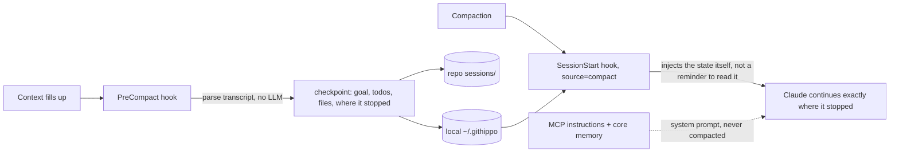

<p align="center">
  
</p>

<p align="center">
  <a href="https://github.com/AnxovatomicaES/githippo/actions/workflows/ci.yml"></a>
  
  
  
  
</p>

<h3 align="center">Claude forgets everything when the context compacts.<br>githippo doesn't.</h3>

<p align="center">
  
</p>

Long-term memory for Claude and any MCP client, stored as plain Markdown in **your own private GitHub repo**. Hybrid semantic search, a knowledge graph, auto-memory, compaction survival, and about 46% less per-turn overhead than a naive memory server. Every memory is a git commit you can read, diff and revert.

```bash
npx -y github:AnxovatomicaES/githippo#v3.1.4 demo     # try it in 30 seconds, no repo or token
npm i -g github:AnxovatomicaES/githippo#v3.1.4 && githippo install
```

Or as a Claude Code plugin: install githippo globally first (the plugin's hooks call the `githippo` command and stay silent if it's missing, so they never slow a prompt), then `/plugin marketplace add AnxovatomicaES/githippo` and `/plugin install githippo`. Or hand your agent [`INSTALL_FOR_AGENTS.md`](INSTALL_FOR_AGENTS.md).

<p align="center">
  <a href="https://render.com/deploy?repo=https://github.com/AnxovatomicaES/githippo"></a><br>
  <sub>one click → use it from claude.ai and your phone</sub>
</p>

---

## Why another memory server?

Because each good idea out there lives in a different tool. githippo takes the best of each and fixes the part that hurts:

| Idea | Borrowed from | githippo's twist |
|---|---|---|
| Entities + relations + observations | MCP reference memory server | Entities are Markdown files, relations are `[[wikilinks]]`, and search is **semantic, not substring**: "the language I prefer" finds "TypeScript" |
| Markdown you can edit, Obsidian graph | Basic Memory | Same human-readable files, but **synced through git**: every device, full history, zero cloud fees |
| Typed relations (`works_on [[x]]`) | Basic Memory, Dataview | Parsed into a queryable graph; recall follows links one hop automatically |
| Temporal facts ("what was true last quarter?") | Graphiti / Zep | Superseded facts move to a dated **History** section instead of vanishing, *and* `history at=<date>` gives exact time travel from git, with no graph DB and no LLM calls |
| Pinned "core memory" blocks | Letta (MemGPT) | Core memory rides **inside the MCP server instructions**, which live in the system prompt, so it survives compaction in *every* client, including claude.ai |
| Lifecycle hooks around compaction | claude-mem | The PreCompact hook builds the checkpoint **deterministically from the transcript** (goal, todo state, files changed, where it stopped). No LLM, no cost, can't hallucinate |
| Progressive disclosure | claude-mem | `recall mode=brief` returns one-line refs (~45 tokens) before you pay for full context |
| Consolidation / dedupe | mcp-memory-service, Mem0 | Embedding-based duplicate detection on every write, plus `maintain` health reports; optional LLM merge that **refuses lossy rewrites** (dropped links or frontmatter) |
| Remote MCP for claude.ai | Supermemory, Mem0 | Self-hosted Streamable HTTP; your data never leaves your repo and your server |

Version 3.1 adds the best idea from each of nine other memory tools, read in their source and credited in [docs/prior-art.md](docs/prior-art.md): `<private>` tags, compaction steering and summary capture, session diffing, activity-aware decay, a code-aware tokenizer, errors in checkpoints, an honest status line, plugin packaging and `alwaysLoad` registration.

And things we haven't seen elsewhere, as far as we know:

- **Compliance guard.** Blocks API keys, tokens, private keys, IBANs (mod-97 checked), card numbers (Luhn checked), Spanish DNI/NIE (checksum) and US SSNs *before* they become permanent git history.
- **Compaction-proof by design**, three ways (see below).
- **Cross-lingual recall.** The default multilingual embedder runs locally; ask in Spanish, find notes written in English.
- **Updates are never mistaken for duplicates.** "Launch is end of Q1" and "end of Q2" embed almost identically. githippo also compares numbers, dates and names, so the update is saved, the old line is flagged, and `maintain` reports possible contradictions. Measured in [docs/calibration.md](docs/calibration.md).
- **Optimistic concurrency.** Two sessions editing the same memory can't clobber each other; the loser gets the current file back and merges.

## Survives compaction, three layers deep

When Claude Code compacts a long session, the conversation gets summarised and details die. githippo makes sure what matters doesn't.



1. **Core memory in the system prompt.** MCP server instructions aren't part of the conversation, so compaction can't touch them. Your pinned facts are always there, in any MCP client.
2. **Hook-driven checkpoint** (Claude Code). A common complaint is that a post-compaction hook which only *reminds* Claude to re-read a state file is hit or miss. githippo injects the content directly.
3. **`checkpoint` tool** (any client, including claude.ai). Claude saves task, state and next step at milestones. After context loss, `checkpoint` with no args restores it.

Bonus: a fresh session in the same project and branch within 24h gets a brief "last time you were…" note, including what changed in git since (commits, commits by others, branch switches, deleted files). The **UserPromptSubmit** hook proactively surfaces up to three relevant memories when the match is confident. It's capped at 300 tokens, skips trivial prompts and never repeats within a session. Before compaction, githippo also tells the compactor what must survive, and after compaction it keeps the compactor's summary with the checkpoint.

How we know the hooks do what we say: the contracts were read from Claude Code's own code (2.1.258). PreCompact passes each successful hook's stdout to the compactor as custom instructions (Claude Code also shows that text in the transcript as "PreCompact … completed successfully"); PostCompact receives `compact_summary`; every hook receives `session_id`, `transcript_path` and `cwd`; SessionStart sources are `startup`, `resume`, `clear`, `compact` and `fork`.

Wrap anything in `<private>…</private>` and it never reaches memory. Turn hooks off without editing files: `GITHIPPO_HOOK_PROFILE=minimal` or `GITHIPPO_DISABLED_HOOKS=prompt,steer`.

## Token budget (measured, `githippo bench`)

| | v2 (naive) | **githippo** |
|---|---|---|
| Tools | 12 | **8** |
| Model-visible schema, every turn | ~1,380 tok | **~760 tok** |
| Instructions | ~340 tok | **~176 tok** + your core |
| Typical recall response | ~190 tok (JSON) | **~117 tok** pack / **~47 tok** brief |

How: terse schemas, the redundant `$schema` URL stripped from `tools/list`, compact text responses instead of pretty JSON, wikilinks rendered as plain words, frontmatter stripped, 8-char version handles, History/index/sessions/core excluded from recall by default, and token budgets on every pack.

## Tools

| Tool | What it does |
|---|---|
| `recall` | Hybrid search (BM25 + embeddings, fused with reciprocal rank fusion) + one-hop graph expansion → token-budgeted context pack. `mode=brief` for refs only |
| `remember` | Save a fact. Auto-routes to the right entity, dedupes, auto-links people/projects, flags what it may supersede. `replaces=` supersedes, `pin=` adds to core |
| `forget` | Remove an exact fact |
| `graph` | Typed relations around an entity |
| `history` | Commit timeline, or the file as of a date |
| `checkpoint` | Save or resume working state |
| `maintain` | Duplicates, possible contradictions, orphans, broken links, stale inbox; rebuild index; activity-aware decay; LLM merge |
| `files` | Raw list/read/write/edit/delete with version checks |

## Setup

**1. Create a private repo** for your memory, e.g. `you/my-memory`, with one initial commit.

**2. Create a fine-grained token**: GitHub → Settings → Developer settings → Fine-grained tokens. Scope it to **only that repo**, permission **Contents: Read and write**.

**3. Pick your client:**

<details><summary><b>Claude Code</b> (full experience: hooks + MCP)</summary>

```bash
npm i -g github:AnxovatomicaES/githippo#v3.1.4
githippo install        # asks for repo + token, writes ~/.githippo/config.json (600), adds hooks
claude mcp add githippo --scope user -- githippo serve
githippo init           # seeds core.md, index.md, inbox.md
githippo doctor         # verifies everything, including that your repo is private
```
</details>

<details><summary><b>Claude Desktop</b></summary>

`~/Library/Application Support/Claude/claude_desktop_config.json`:

```json
{
  "mcpServers": {
    "githippo": {
      "command": "npx",
      "args": ["-y", "github:AnxovatomicaES/githippo#v3.1.4", "serve"],
      "env": { "GITHUB_TOKEN": "github_pat_...", "MEMORY_REPO": "you/my-memory" }
    }
  }
}
```
</details>

<details><summary><b>claude.ai, iOS and Android</b> (remote)</summary>

1. Click **Deploy to Render** above (or run `githippo http` anywhere with Node 20+).
2. Set `GITHUB_TOKEN` and `MEMORY_REPO`. `MCP_SECRET` is generated for you.
3. In claude.ai: Settings → Connectors → Add custom connector → `https://<your-app>.onrender.com/mcp/<MCP_SECRET>`.

Connectors you add on the web are available in the mobile apps too.
</details>

<details><summary><b>Cursor, Windsurf, VS Code, any MCP client</b></summary>

Local: command `githippo serve` with the two env vars. Remote: URL `https://host/mcp` with header `Authorization: Bearer <MCP_SECRET>`.
</details>

## Memory format

Plain Markdown, Obsidian-compatible. Open the repo as a vault and you get the graph view for free.

```markdown
---
name: billing-v2
title: Billing v2
type: project
description: Billing rewrite
aliases: [billing rewrite]
---

## Decisions
- Use idempotency keys on every write endpoint
- owner:: [[sam-okafor]]
- Launch target is end of Q1

## History
- ~~Launch target is end of Q4~~ (until 2026-09-30)
```

Layout: `core.md` (pinned), `index.md` (table of contents), `inbox.md` (unrouted facts), `people/`, `projects/`, `topics/`, `decisions/`, `sessions/` (checkpoints). See [`examples/memory`](examples/memory).

## Configuration

| Variable | Default | |
|---|---|---|
| `GITHUB_TOKEN`, `MEMORY_REPO` | | required |
| `MCP_SECRET` | | remote mode, 24+ chars |
| `EMBEDDINGS` | `local` | `local` (paraphrase-multilingual-MiniLM-L12-v2, CPU, one-time model download, ~860 MB RAM), `voyage`, or `none` (keyword only). Choice and thresholds are measured in [docs/calibration.md](docs/calibration.md) |
| `MEMORY_ROOT` / `MEMORY_BRANCH` | `memory` / `main` | |
| `CORE_BUDGET_TOKENS` | `400` | hard cap for pinned memory |
| `PROMPT_RECALL` | `1` | `0` turns off the per-prompt hook |
| `ANTHROPIC_API_KEY` | | only for `maintain rewrite=` |
| `VOYAGE_API_KEY` | | for `EMBEDDINGS=voyage` |

## Security model, honestly

- **Your repo, your data.** githippo has no backend. Keep the memory repo **private**; `doctor` warns if it isn't.
- **Least privilege.** Use a fine-grained token limited to one repo with Contents read/write only.
- **Remote auth** is a high-entropy secret in the URL or a Bearer header, compared in constant time and rate limited. Treat the connector URL like a password. OAuth 2.1 is on the roadmap.
- **The guard is a backstop, not DLP.** It catches common secret and ID formats. `forget` removes a line from the current file, but git history keeps it; purging needs a history rewrite.
- **Hooks never break your session.** Every failure path exits 0 with a short timeout.

## Develop

```bash
npm ci && npm test      # 64 tests: unit, hooks, adopted features, bug regressions, end-to-end over Streamable HTTP with the official MCP client
npm run bench           # token cost of the tool surface
```

## Roadmap

OAuth 2.1 for remote · MCP Registry listing · Claude Desktop extension bundle · usage-weighted ranking · multi-user vaults with per-folder ACLs

MIT licensed. PRs welcome.
